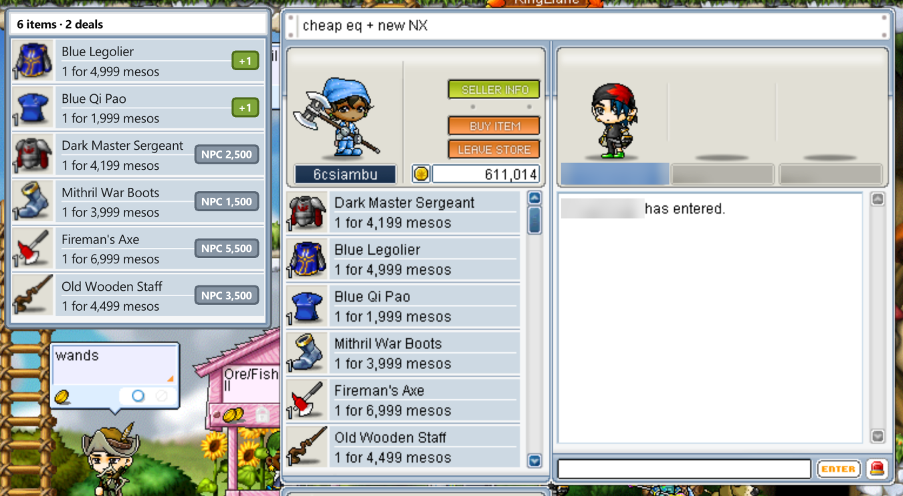
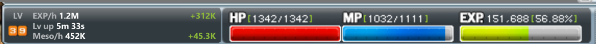

# MapleStory Classic Tool

A screen-reading companion for **MapleStory Classic** on Windows. It watches the
game window, reads what is on screen, and draws helpful information on top of it:

- **Price checker.** Open any player shop in the Free Market and a list beside it
  shows which listings an NPC will buy for more than the asking price.
- **EXP tracker.** EXP per hour, the time until your next level, and the EXP
  gained this session.
- **Meso tracker.** Mesos per hour and mesos earned this session, read from your
  inventory.
- **Alt+Shift blocker.** Stops Windows from switching your keyboard language
  every time you press Alt+Shift in game.

The app is called **MapleStory Classic Tool** (`MapleStoryClassicTool.exe`).

> **It only reads the screen.** MapleStory Classic Tool takes screenshots of the game window and
> reads the pixels, the same way you read them with your eyes. It never opens,
> reads or writes the game's process or memory, never injects anything, never
> sends input to the game and never touches its network traffic.





*(The screenshots come from the test images, where the author's character name
is blurred.)*

---

## Contents

- [Features](#features)
- [Requirements](#requirements)
- [Getting started](#getting-started)
- [Using MapleStory Classic Tool](#using-maplestory-classic-tool)
- [Settings and files](#settings-and-files)
- [How it works](#how-it-works)
- [Development](#development)
- [Limitations](#limitations)
- [Disclaimer](#disclaimer)
- [License](#license)

---

## Features

### Price checker (Free Market player shops)

- When you open a player shop, a **side list** styled like the shop window
  appears next to it: left of the shop, or right of it when there is no room.
- The title reads `N items · D deals`. Below it, every listing an NPC buys for
  more than its price is shown, **most profitable first**: the item's icon and
  name, the shop's price line (`1 for 3,000 mesos`) and a green profit badge
  (`+12,345`).
- **Show all rows** (on by default) also lists the other items, each with a grey
  `NPC 1,234` badge showing what the NPC pays. Items MeowDB has no NPC price for
  are left out.
- **It remembers the whole shop.** Scroll through a shop once and every item stays
  listed until you close it. Identical listings show as `(x2)`. Hovering the
  shop's buttons doesn't clear the list; it stays as long as the shop's title is
  on screen.
- **Sold-out rows** (drawn faded by the game) are skipped.
- **Throwing stars and bullets** are valued as one set per listing.
- **Cut-off names.** If a name the shop cuts off (`Two-handed Axe Attack S...`)
  could be any of several scrolls worth the same to the NPC, it is shown as
  read rather than guessed.
- **Nothing is guessed.** A row that can't be read with confidence, or doesn't
  match the price list, is never shown or counted.
- NPC prices come from the [MeowDB](https://meowdb.com) item database. It is
  downloaded on first launch and cached locally.

### EXP tracker

It takes over the LV / job / character-name box at the bottom left of the status
bar, in the panel's own colours. The level stays visible in the corner, followed
by three lines:

| Line | Meaning |
|---|---|
| `EXP/h 1.2M` &nbsp; `+312K` | EXP per hour over the last 10 minutes, and EXP gained this session |
| `Lv up 5m 33s` &nbsp; `idle` | Time to the next level at the current rate (`idle` after 5 minutes without EXP) |
| `Meso/h 452K` &nbsp; `+45.3K` | Mesos per hour and mesos earned this session, or `open inv` when the inventory is closed |

- It reads `EXP. 151,688 [56.88%]` from the status bar once per second, with or
  without a shop open.
- Numbers appear after one minute and two EXP gains. Until then the box shows
  `—`.
- **Idle time doesn't count.** After 5 minutes without EXP the rate freezes, and
  the idle gap is skipped once you start gaining again.
- **Level-ups** carry the gain over.
- **Misreads are thrown out.** EXP that goes down, or an EXP / percentage pair
  that doesn't fit, is discarded. EXP lost on death is never subtracted.
- **A new session starts** when you press **On**, or after you've been on a
  different map for 30 seconds. The map is told apart by the minimap's map name,
  in either the expanded or the collapsed minimap. Going back within 30 seconds
  keeps the session.
- The box hides while the status bar is hidden, for example in the Cash Shop.

### Meso tracker

- **Where it reads from.** Mesos are read from the item inventory's meso box. It
  still works when the inventory is dragged partly off the left edge, as long as
  the meso number is fully visible.
- **Only gains count**: drops, quest rewards, NPC sales. Spending is never
  subtracted.
- **No one-off misreads.** A new value counts only once two readings in a row
  agree.
- **Inventory closed.** The line says `open inv`. Mesos earned meanwhile are
  counted once it's open again.

### Alt+Shift language blocker

MapleStory players press Alt+Shift a lot. On a PC with several keyboard languages
it keeps switching the input language. While MapleStory Classic Tool is open:

- Windows' Alt+Shift language shortcut is turned off. It's the same setting as
  *Settings → Time & language → Typing → Advanced keyboard settings → Input
  language hot keys*.
- **Win+Space** still switches languages.
- **Closing MapleStory Classic Tool** (or unticking the box) puts the shortcut back exactly as
  it was. Your original setting is saved to a file first, so if MapleStory Classic Tool
  crashes, the next start restores it.
- It changes only your own Windows setting and never looks at the game.

---

## Requirements

- **Windows 10 or 11.**
- **MapleStory Classic**, windowed or borderless, at any size and on any
  monitor.
  - The game draws its UI at a base height of 768 px, and MapleStory Classic Tool works out the
    matching scale on its own: 1366×768 at 3840×2160, 1228×768 at 2560×1600, and
    so on.
  - Exclusive fullscreen may hide the overlay.
- **Internet on first launch**, to download the MeowDB price list. After that it's
  cached and refreshed weekly.
- *Optional:* the **English Windows OCR language pack**. It's a fallback for text
  the built-in reader can't identify. Install it from *Settings → Time & language
  → Language → English (United States) → Optional features → OCR*.

---

## Getting started

### Option A: build the exe

```bat
git clone https://github.com/oleg1994/maplestory-classic-tool.git
cd maplestory-classic-tool
python -m venv .venv
.venv\Scripts\pip install -e .[dev]
build.bat
```

This produces a single file, `dist\MapleStoryClassicTool.exe`. Double-click it to start.

To smoke-test the build without opening a window, run
`dist\MapleStoryClassicTool.exe --selftest` (exit code 0 means OK).

### Option B: run from source

```bat
python -m venv .venv
.venv\Scripts\pip install -e .[dev]
.venv\Scripts\python -m maplestory_classic_tool --gui
```

Requires Python 3.10 or newer.

---

## Using MapleStory Classic Tool

A small **MapleStory Classic Tool** window opens in the **Off** state. Nothing is
captured until you press **On**.

| Control | What it does |
|---|---|
| **On / Off** | Start and stop reading the screen. |
| **Show all rows** | Also list shop items that aren't a deal, with what the NPC pays (on by default; items with no NPC price on MeowDB are never listed). |
| **EXP tracker** | Show the EXP / meso box on the status bar. |
| **Block Alt+Shift language switch** | Turn Windows' Alt+Shift language shortcut off while MapleStory Classic Tool is open. |
| **Restart as admin** | Shown only when not elevated. Needed only if the game runs as administrator and you want the hotkeys below. |

The status line shows one of:

- `Off`
- `On - waiting for game`
- `On - no shop open`
- `On - shop found (N deals)`
- `No price data`

**Hotkeys** (global, so the game won't receive them while MapleStory Classic Tool runs):

| Key | Action |
|---|---|
| **F8** | Rescan now and clear the collected shop list |
| **F9** | Hide the side list until it changes |

You can change them in `settings.json` (see below).

**Screenshots.** The overlay is hidden from screen capture: Print Screen, the
Snipping Tool, OBS and Discord streaming all show the game without it. This is
deliberate, because the tool's own capture must not see what it draws. Only one
copy runs at a time.

---

## Settings and files

Everything lives in `%LOCALAPPDATA%\MapleStoryClassicTool`:

| File | Contents |
|---|---|
| `settings.json` | Your options: `show_all`, `exp_tracker`, `block_alt_shift`, hotkeys (`hotkey_scan`, `hotkey_clear`), `window_title`, `catalog_max_age_days` and the remembered UI scale per window size (`base_sizes`). |
| `catalog.json` | Cached MeowDB price list (refreshed when older than `catalog_max_age_days`, default 7). |
| `log.txt` | Log: window rectangle and UI scale, capture backend, memory use. |
| `lang_hotkey_backup.json` | Exists only while Alt+Shift is blocked: your original hotkey setting. |

MapleStory Classic Tool connects to the internet for only one thing: downloading the price list
from MeowDB. It sends nothing else anywhere.

---

## How it works

Everything is plain image processing on screenshots of the game window, done with
OpenCV and NumPy.

1. **Capture.** The game window's client area is grabbed with
   [dxcam](https://github.com/ra1nty/DXcam) (Desktop Duplication), or with
   [mss](https://github.com/BoboTiG/python-mss) when the window spans two
   monitors. About 10 times a second while a shop is open, 4 times otherwise.
2. **Normalise.** The frame is scaled to the game's base UI resolution (height
   768), so all layout geometry is in fixed "base pixels".
3. **Find the UI** by template matching (`maplestory_classic_tool/assets/*.png`):
   - shop window: its button block
   - status bar: the `LV.` box
   - inventory: the `MESOS` label
   - minimap: the `WORLD` button
4. **Read the text with the game's own pixel fonts.** Shop rows use glyph
   templates learned from labelled screenshots (`assets/glyphs.json`). The EXP
   bar and the meso box use small hand-checked digit patterns
   (`maplestory_classic_tool/exp.py`, `maplestory_classic_tool/meso.py`). Windows OCR is only a fallback.
5. **Price.** Item names are fuzzy-matched against the MeowDB catalog
   ([RapidFuzz](https://github.com/rapidfuzz/RapidFuzz)), and profit = NPC price ×
   quantity − asking price.
6. **Draw** a click-through, always-on-top Tk window over the game. It is
   excluded from screen capture (`WDA_EXCLUDEFROMCAPTURE`), so step 1 never sees
   it.

### Project layout

| Path | Contents |
|---|---|
| `maplestory_classic_tool/panel.py` | Control window (the app's entry point) |
| `maplestory_classic_tool/gamewidgets.py` | Game-style frame, title bar, buttons and checkboxes for the control window |
| `maplestory_classic_tool/session.py`, `live.py` | Scan worker, hotkeys, live loop |
| `maplestory_classic_tool/scanner.py`, `shop.py`, `detect.py`, `glyphs.py`, `layout.py` | Shop window detection and row reading |
| `maplestory_classic_tool/catalog.py`, `evaluate.py` | MeowDB catalog and deal evaluation |
| `maplestory_classic_tool/sidelist.py`, `overlay.py`, `draw.py` | Side list and EXP box drawing |
| `maplestory_classic_tool/exp.py`, `meso.py`, `rate.py`, `mapid.py` | EXP / meso reading, rates, map-change detection |
| `maplestory_classic_tool/langhotkey.py` | Alt+Shift blocker |
| `maplestory_classic_tool/calibrate.py` | Tools for retraining glyphs and checking layout |
| `maplestory_classic_tool/assets/` | Templates, layout, glyphs, icon |
| `packaging/` | PyInstaller spec, entry script, icon generator |
| `tests/` | pytest suite; `tests/fixtures/shops/` has labelled screenshots |

---

## Development

```bat
.venv\Scripts\python -m pytest -q
```

The suite runs against the labelled screenshots in `tests/fixtures/shops/`. Each
`.png` has a `.json` next to it with the expected rows. Tests marked `live` need
the running game and are skipped by default.

**Preview on a screenshot.** This draws the side list and EXP box exactly as the
live overlay would:

```bat
python -m maplestory_classic_tool --image shot.png --out annotated.png [--show-all] [--exp-demo]
```

`--exp-demo` fills the EXP box with sample rates. A single screenshot otherwise
shows `—`.

**Headless mode** is always on, with no control window (Ctrl+C quits):
`python -m maplestory_classic_tool`.

**After a game UI patch**, or to teach the reader new letters:

```bat
python -m maplestory_classic_tool.calibrate draw <shot.png> --out dbg.png
python -m maplestory_classic_tool.calibrate build tests/fixtures/shops --out maplestory_classic_tool/assets/glyphs.json [--holdout NAME]
```

- `draw` overlays the detected anchor and row boxes on a screenshot.
- `build` relearns the glyph templates from the labelled fixtures. With
  `--holdout NAME` it leaves one fixture out and reports how well the result
  reads it.
- If boxes are misplaced, update `maplestory_classic_tool/assets/layout.json`. It holds every
  box relative to its anchor, in base pixels.
- `docs/glyph-checklist.md` tracks which item names were captured to teach which
  letters.

**Icon.** `packaging/make_icon.py` draws `maplestory_classic_tool/assets/app.ico`; add
`--preview sheet.png` to see every size.

Contributions are welcome. New labelled screenshots of shops are especially
useful; blur your own character name first if you want to stay anonymous.

---

## Limitations

- **Windows only.**
- Made for **MapleStory Classic**'s default UI skin and fonts.
- Exclusive fullscreen may hide the overlay.
- If the game runs as administrator, the F8 / F9 hotkeys only work when MapleStory Classic Tool
  runs as administrator too. Everything else works either way.
- **Throwing stars and bullets** assume the base set size. With Claw Mastery a
  full set is larger, so the NPC pays less per star than shown.
- Prices are only as accurate as the MeowDB data.

---

## Disclaimer

This is an unofficial fan project. It isn't affiliated with, endorsed by or
connected to Nexon or MeowDB. MapleStory is a trademark of Nexon. Read your
game's terms of service and decide for yourself whether to use third-party tools.
MapleStory Classic Tool only reads pixels from your screen, but you use it at your own risk.

Please be considerate with the MeowDB API: the catalog is cached and refreshed at
most once a week.

## License

[MIT](LICENSE)
